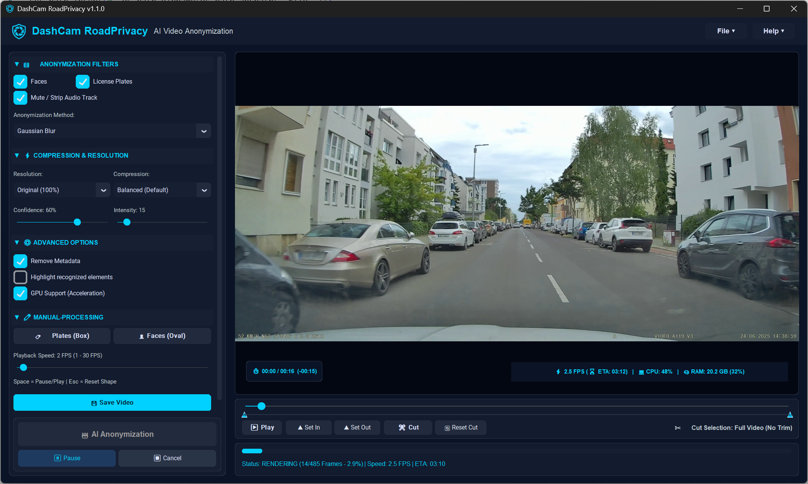

# DashCam RoadPrivacy

[](https://github.com/engstaNET/DashCam_RoadPrivacy/releases)
[](https://github.com/engstaNET/DashCam_RoadPrivacy)
[](LICENSE)
[](PRIVACY.md)

**DashCam RoadPrivacy** is a high-performance, standalone Windows application engineered for automated AI-powered video anonymization. Designed specifically for DashCam footage, action camera recordings, and public video captures, it automatically detects and redacts faces and vehicle license plates while offering GPU DirectML hardware acceleration, interactive manual post-processing redaction, and customizable compression.



---

## 🌟 Key Features

- **⚡ Dual AI Engine Detection:**
  - **License Plates:** Dedicated deep learning **RT-DETRv2 ONNX** model combined with multi-stage YOLOv8 and Haar Cascade verification for high-precision country-neutral automotive plate detection.
  - **Faces:** Ultra-fast OpenCV YuNet DNN Face Detector tuned for distant and small faces in public street scenes.
- **🚀 GPU Hardware Acceleration:** Microsoft DirectML & ONNX Runtime support for NVIDIA, AMD, and Intel GPUs, plus multi-threaded CPU fallback.
- **✏️ Interactive Manual-Processing Mode:** Frame-by-frame manual redaction tool allowing custom bounding boxes and shapes with instant timeline scrubbing and synchronization.
- **🔒 100% Local & Private:** Runs entirely offline on your PC. No internet connection required, zero cloud uploads, and zero telemetry.
- **✂️ Lossless Stream-Copy Video Trimming:** Keyframe-aligned sub-second fast trim without video re-encoding when cutting.
- **🎛️ Anonymization Customization:**
  - **Redaction Modes:** Gaussian Blur, Mosaic Pixelation, and Solid Blackout.
  - **Adjustable Controls:** Dynamic confidence thresholding and blur intensity sliders.
- **🛡️ Metadata Stripping & Audio Control:** Strip EXIF/GPS telemetry metadata and optionally mute or preserve audio tracks.
- **🎬 Branded Outro Sequence:** Appends a clean 2-second branded closing screen with centered logo at video resolution.
- **📦 Portable Standalone Executable:** Self-contained package bundling FFmpeg and all AI models. No Python installation or external dependencies required. Simply download, extract, and run.

---

## 📥 Download & Installation

### Latest Release: **v1.1.0**

1. Go to the [Releases](https://github.com/engstaNET/DashCam_RoadPrivacy/releases) page.
2. Download `DashCam_RoadPrivacy_v1.1.0_win64.zip`.
3. Extract the ZIP archive to any directory on your PC.
4. Launch `RoadPrivacy_v1.1.0.exe`.

> **Note for Windows Defender / SmartScreen:**  
> Since the executable is freshly built and self-signed, Windows Defender SmartScreen may show an informational warning. Click **More info** -> **Run anyway**.

---

## 🔐 Security & SHA-256 Verification

To ensure that your download has not been tampered with, you can verify the SHA-256 hash against the official values below:

| File Name | Target Platform | SHA-256 Hash |
| :--- | :--- | :--- |
| **`DashCam_RoadPrivacy_v1.1.0_win64.zip`** | Windows 10/11 x64 | `PENDING_BUILD_HASH` |

### Verifying Hashes in Windows PowerShell:

```powershell
Get-FileHash -Algorithm SHA256 .\DashCam_RoadPrivacy_v1.1.0_win64.zip
```

---

## 🖥️ System Requirements

- **Operating System:** Windows 10 or Windows 11 (64-bit)
- **Processor:** Dual-Core x86-64 CPU (Quad-Core or higher recommended)
- **Memory:** 4 GB RAM (8 GB recommended)
- **Graphics (Optional):** DirectX 12 compatible GPU for DirectML hardware acceleration (NVIDIA GeForce, AMD Radeon, Intel Arc/Iris)

---

## 📄 License & Attribution

This software is distributed under the [Freeware License Agreement](LICENSE). Free to use for personal and commercial purposes.  
For third-party components and AI model licenses, see [THIRD_PARTY_LICENSES.md](THIRD_PARTY_LICENSES.md).

Developed by **Artur F.** ([engstaNET](https://github.com/engstaNET)).
